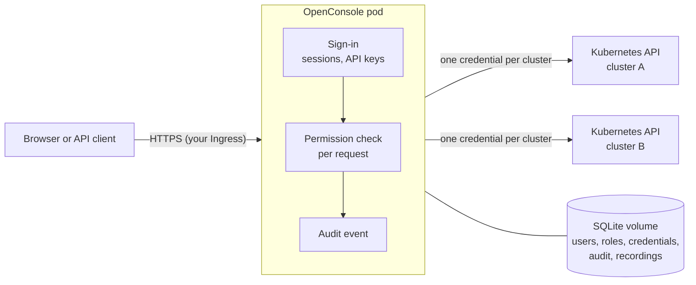

# Security model

This page describes how OpenConsole 2.23.0 protects the clusters it connects to, for a security review. Every
statement links to the code or manifest line that implements it (tag `v2.23.0`). What an operator should set up
around it is in the [Production hardening checklist](/operations/hardening).

## What OpenConsole can reach in a cluster {#what-openconsole-can-reach-in-a-cluster}

- **Only what an admin connects.** OpenConsole talks to a cluster only with the credentials an admin adds under
  Admin → Clusters (a ServiceAccount token or a kubeconfig). It finds no cluster on its own and doesn't use the
  pod's own identity: the manifest mounts no ServiceAccount token into the pod
  ([deployment.yaml#L31](https://github.com/vurulkan/kubernetes-openconsole/blob/v2.23.4/deploy/deployment.yaml#L31)).
  A kubeconfig may carry only inline credentials: one with an exec plugin, an `auth-provider` or a file path is
  refused (`kubeconfig_unsupported`), so connecting a cluster can't run a program or read a file in the pod
  ([manager.go](https://github.com/vurulkan/kubernetes-openconsole/blob/v2.23.4/backend/internal/kube/manager.go)).
- **The ClusterRole you give that credential is the upper bound** for everyone, admins included. The manifest's
  ClusterRole ([rbac.yaml#L36-L124](https://github.com/vurulkan/kubernetes-openconsole/blob/v2.23.4/deploy/rbac.yaml#L36-L124)) reads workloads, pods, services, config maps,
  events, nodes and metrics; reads and updates Secrets; reads pod logs; creates `pods/exec`; updates and patches
  workloads (YAML apply, restart, scale). It has no `create` or `delete` on any object, and no `services/proxy`
  unless you uncomment it for Prometheus. A view-only variant without any write verb is
  [rbac-readonly.yaml](https://github.com/vurulkan/kubernetes-openconsole/blob/v2.23.4/deploy/rbac-readonly.yaml#L30). Every rule and the feature it serves:
  [Kubernetes permissions](/reference/kubernetes-permissions).
- **Kubernetes sees OpenConsole, not the person.** The API server's audit log shows the connected identity for
  every user's action. Who did it is in OpenConsole's own audit log ([below](#what-is-recorded)).
- **A shell runs in the existing container, as its user**, through the API server's `pods/exec`. The cluster's own
  pod policies (for example non-root admission policies) still apply to shells.
- **Secrets are read on demand.** Lists and workloads come from an in-memory watch cache; Secrets are not watched or
  cached and are fetched from the API server for each request ([resources.go#L526-L545](https://github.com/vurulkan/kubernetes-openconsole/blob/v2.23.4/backend/internal/kube/resources.go#L526-L545),
  the rule's comment [rbac.yaml#L46-L49](https://github.com/vurulkan/kubernetes-openconsole/blob/v2.23.4/deploy/rbac.yaml#L46-L49)).

## Who may do what {#who-may-do-what}

- **Permissions are granted in OpenConsole**, per role: a resource and an action (`pods:exec`, `secrets:reveal`, …)
  in a namespace, on one cluster or all of them ([engine.go#L13-L28](https://github.com/vurulkan/kubernetes-openconsole/blob/v2.23.4/backend/internal/rbac/engine.go#L13-L28)).
  Users get roles through groups. Admins hold every permission
  ([router.go#L72-L81](https://github.com/vurulkan/kubernetes-openconsole/blob/v2.23.4/backend/internal/api/access.go#L72-L81)). The catalog:
  [Permissions](/reference/permissions).
- **The server checks every request.** Each handler calls one check
  ([`requirePermission`, router.go#L116-L140](https://github.com/vurulkan/kubernetes-openconsole/blob/v2.23.4/backend/internal/api/access.go#L116-L140)), which evaluates the
  caller's grants for the request's cluster and namespace ([`Can`, engine.go#L151](https://github.com/vurulkan/kubernetes-openconsole/blob/v2.23.4/backend/internal/rbac/engine.go#L151)).
  The UI hides what you can't use, but hiding is not the control. A refusal answers `403` with a reason code and is
  audited as `denied`. Admin screens use one admin check
  ([`isAdminRequest`, router.go#L34-L43](https://github.com/vurulkan/kubernetes-openconsole/blob/v2.23.4/backend/internal/api/access.go#L34-L43)).
- **A user who hasn't changed the initial password** gets no permission at all
  ([router.go#L48-L55](https://github.com/vurulkan/kubernetes-openconsole/blob/v2.23.4/backend/internal/api/access.go#L48-L55)), and an admin in that state is not an admin
  ([router.go#L36](https://github.com/vurulkan/kubernetes-openconsole/blob/v2.23.4/backend/internal/api/access.go#L36)).
- **Feature flags switch a capability off for everyone**, admins included, at the same check: `FEATURE_POD_EXEC`,
  `FEATURE_SECRET_REVEAL`, `FEATURE_API_KEYS`, … ([features.go#L59](https://github.com/vurulkan/kubernetes-openconsole/blob/v2.23.4/backend/internal/api/features.go#L59),
  [router.go#L122-L126](https://github.com/vurulkan/kubernetes-openconsole/blob/v2.23.4/backend/internal/api/access.go#L122-L126)).
- **An API key is never more than its owner.** What a key may do is what the key lists, intersected with what its
  owner holds now, intersected with the admin's API access policy
  ([router.go#L59-L69](https://github.com/vurulkan/kubernetes-openconsole/blob/v2.23.4/backend/internal/api/access.go#L59-L69),
  [`WithKey`, engine.go#L67](https://github.com/vurulkan/kubernetes-openconsole/blob/v2.23.4/backend/internal/rbac/engine.go#L67),
  [`KeyCeiling`, policy.go#L57](https://github.com/vurulkan/kubernetes-openconsole/blob/v2.23.4/backend/internal/rbac/policy.go#L57)). The default policy for roles is *safe
  read-only*: list, get and logs, without ConfigMaps or Secrets ([`SafeRead`, policy.go#L24](https://github.com/vurulkan/kubernetes-openconsole/blob/v2.23.4/backend/internal/rbac/policy.go#L24)).
  A key can never manage keys, change a password, pick the user's cluster or save views
  ([`denyAPIKey`, apikeys.go#L245](https://github.com/vurulkan/kubernetes-openconsole/blob/v2.23.4/backend/internal/api/apikeys.go#L245)).

## Sign-in and sessions {#sign-in-and-sessions}

- **Local passwords** are stored as bcrypt hashes ([password.go#L12](https://github.com/vurulkan/kubernetes-openconsole/blob/v2.23.4/backend/internal/auth/password.go#L12)), at least
  `PASSWORD_MIN_LENGTH` (8) characters and at most 72 bytes ([password.go#L23-L38](https://github.com/vurulkan/kubernetes-openconsole/blob/v2.23.4/backend/internal/auth/password.go#L23-L38)).
  LDAP accounts are checked by a bind against the directory; Azure AD accounts sign in through Microsoft and never
  accept a local password. An account signs in only through its own source: a local account never accepts a
  directory password, and Microsoft sign-in never takes over a local or LDAP account; an Azure AD account is bound to
  the Entra object (`oid`) that first signed in to it ([router.go#L98-L120](https://github.com/vurulkan/kubernetes-openconsole/blob/v2.23.4/backend/internal/api/auth_handlers.go#L98-L120)).
- **Guessing is slowed down:** after 5 failed sign-ins for one user name from one client address, that pair is locked
  for 5 minutes, and after 20 for one user name from any addresses, the name is (`429`, audited as `user.login`
  `locked`; failures older than 5 minutes are forgotten)
  ([observability.go#L65-L72](https://github.com/vurulkan/kubernetes-openconsole/blob/v2.23.4/backend/internal/api/observability.go#L65-L72),
  [router.go#L73-L79](https://github.com/vurulkan/kubernetes-openconsole/blob/v2.23.4/backend/internal/api/auth_handlers.go#L73-L79)). Every failed sign-in gets the same `401`, so
  the answer doesn't tell whether the account exists ([router.go#L122-L129](https://github.com/vurulkan/kubernetes-openconsole/blob/v2.23.4/backend/internal/api/auth_handlers.go#L122-L129)).
- **Sessions** are signed tokens (JWT, HS256; other algorithms are refused) that end after the inactivity time set
  in Admin → Sessions (60 minutes by default) and at the latest 12 hours after sign-in. Activity moves the end on the
  server; a screen's automatic refresh and a WebSocket reconnecting on its own don't
  ([router.go](https://github.com/vurulkan/kubernetes-openconsole/blob/v2.23.4/backend/internal/api/router.go),
  [sessions.go](https://github.com/vurulkan/kubernetes-openconsole/blob/v2.23.4/backend/internal/store/sessions.go)). Each
  token has a server-side record that is checked on every request, so an admin can revoke one session or all of a
  user's sessions before they expire ([router.go#L37-L51](https://github.com/vurulkan/kubernetes-openconsole/blob/v2.23.4/backend/internal/api/auth_handlers.go#L37-L51)).
  Deactivating a user revokes their sessions at once, and every permission check (shells, logs, reveal, apply, API
  keys included) refuses a deactivated user, or one who still has to change a password an admin set.
- **The browser keeps the session token in local storage** and sends it as an `Authorization: Bearer` header
  ([api.ts#L77](https://github.com/vurulkan/kubernetes-openconsole/blob/v2.23.4/frontend/src/services/api.ts#L77), [api.ts#L117](https://github.com/vurulkan/kubernetes-openconsole/blob/v2.23.4/frontend/src/services/api.ts#L117)); there are
  no session cookies.
- **WebSockets** (logs, shell, live events) never carry the session token in their URL. The page first asks for a
  ticket that works once, within 30 seconds, for one path only
  ([ticket.go#L11-L50](https://github.com/vurulkan/kubernetes-openconsole/blob/v2.23.4/backend/internal/auth/ticket.go#L11-L50)).
- **API keys** start with `oc_` so secret scanners recognise them ([middleware.go#L43-L44](https://github.com/vurulkan/kubernetes-openconsole/blob/v2.23.4/backend/internal/auth/middleware.go#L43-L44)).
  The secret is shown once; the database keeps its SHA-256 digest
  ([apikeys.go#L71-L75](https://github.com/vurulkan/kubernetes-openconsole/blob/v2.23.4/backend/internal/api/apikeys.go#L71-L75)). Keys expire (the admin sets the longest
  lifetime), can be revoked by their owner or an admin, and are limited to 10 requests per second each, bursts of 30
  ([apikeys.go#L44-L45](https://github.com/vurulkan/kubernetes-openconsole/blob/v2.23.4/backend/internal/api/apikeys.go#L44-L45)).

## Where data is kept {#where-data-is-kept}

Everything OpenConsole stores is in one SQLite database on its volume (`/data/app.db`), plus shell recordings in
`/data/recordings`: users and password hashes, groups, roles, cluster credentials, LDAP and Azure AD settings,
Prometheus settings, sessions, API key digests and the audit log.

- **Credentials are encrypted** before they are written: cluster tokens, kubeconfigs and CA certificates
  ([clusters.go#L100-L111](https://github.com/vurulkan/kubernetes-openconsole/blob/v2.23.4/backend/internal/store/clusters.go#L100-L111)), the LDAP bind password
  ([store.go#L548](https://github.com/vurulkan/kubernetes-openconsole/blob/v2.23.4/backend/internal/store/store.go#L548)), the Azure AD client secret
  ([store.go#L631](https://github.com/vurulkan/kubernetes-openconsole/blob/v2.23.4/backend/internal/store/store.go#L631)) and Prometheus settings
  ([clusters.go#L235-L245](https://github.com/vurulkan/kubernetes-openconsole/blob/v2.23.4/backend/internal/store/clusters.go#L235-L245)), with AES-256-GCM and a random nonce per
  value ([crypto.go#L12-L30](https://github.com/vurulkan/kubernetes-openconsole/blob/v2.23.4/backend/internal/store/crypto.go#L12-L30)).
- **Where the key is.** By default it is generated on first start and kept in the same database, and it also signs
  session tokens: whoever has a copy of the database file (the volume, a snapshot, a backup) has the cluster
  credentials and can create sessions. With `ENCRYPTION_KEY_FILE` the key lives in a Kubernetes Secret instead: the
  next start re-encrypts every value with it, deletes the key from the database and rewrites the file so the old key
  doesn't linger, and signs session tokens with a key derived from it, so everyone signs in once more
  ([keys.go](https://github.com/vurulkan/kubernetes-openconsole/blob/v2.23.4/backend/internal/store/keys.go),
  [Backup and restore](/installation/backup-restore)). A copy of the
  database then doesn't reveal the credentials on its own. Either way, protect the volume, its snapshots and backups,
  and limit who can attach a debug container to the OpenConsole pod or read its volume.
- **Shell recordings hold everything a shell printed**, including any secret someone displayed. They are on the same
  volume and only admins can replay or download them.

## What is recorded {#what-is-recorded}

- **Every action and every resource read is an audit event**, allowed or refused: who, from which address, with
  which API key, on which cluster, namespace and object, and the outcome. Events are kept in the database for
  `LOG_RETENTION_DAYS` (30) and written to stdout for your log platform ([Logging](/operations/logging)).
  Event types: [Audit events](/reference/audit-events).
- **Audit details never hold secret values, YAML bodies, passwords or tokens.** Details are a fixed, typed set of
  keys; anything else is dropped ([event.go#L132-L137](https://github.com/vurulkan/kubernetes-openconsole/blob/v2.23.4/backend/internal/audit/event.go#L132-L137)). A secret reveal
  records the key's name ([secrets.go#L23-L24](https://github.com/vurulkan/kubernetes-openconsole/blob/v2.23.4/backend/internal/api/secrets.go#L23-L24)), a YAML apply records
  short SHA-256 hashes (8 hex characters) of the object before and after, not the YAML ([yaml_apply.go#L119-L121](https://github.com/vurulkan/kubernetes-openconsole/blob/v2.23.4/backend/internal/api/yaml_apply.go#L119-L121),
  [yaml_apply.go#L165-L168](https://github.com/vurulkan/kubernetes-openconsole/blob/v2.23.4/backend/internal/api/yaml_apply.go#L165-L168)).
- **Secret values leave the server only when asked for one at a time:** list and get return names, types and key
  names; `secrets:reveal` returns one key's value per request, each one audited
  ([secrets.go#L20-L28](https://github.com/vurulkan/kubernetes-openconsole/blob/v2.23.4/backend/internal/api/secrets.go#L20-L28)).
- **Shells are recorded** when recording is on (Admin → Recordings). A shell or a command run with an API key is
  always recorded, and refused if it can't be ([pod_exec.go#L200-L206](https://github.com/vurulkan/kubernetes-openconsole/blob/v2.23.4/backend/internal/api/pod_exec.go#L200-L206),
  [pod_exec_command.go#L188-L193](https://github.com/vurulkan/kubernetes-openconsole/blob/v2.23.4/backend/internal/api/pod_exec_command.go#L188-L193)).

## HTTP {#http}

- OpenConsole serves plain HTTP on port 8080; TLS ends at your Ingress or Gateway
  ([Install on Kubernetes](/installation/kubernetes#ingress-with-tls)).
- **Response headers** on every answer ([observability.go#L17-L44](https://github.com/vurulkan/kubernetes-openconsole/blob/v2.23.4/backend/internal/api/observability.go#L17-L44)):
  `Content-Security-Policy` (scripts only from the app itself, the YAML editor included,
  `frame-ancestors 'none'`), `X-Frame-Options: DENY`, `X-Content-Type-Options: nosniff`,
  `Referrer-Policy: strict-origin-when-cross-origin`, `Permissions-Policy` turning off geolocation, camera,
  microphone and payment. The CSP also has `worker-src blob:` and, in `script-src`, `'wasm-unsafe-eval'`, so the
  bundled recording player can compile its WebAssembly terminal; that allows WebAssembly compilation only, not
  JavaScript `eval`.
- **Without sign-in** answer only: `/livez`, `/readyz`, `/healthz`, `/metrics`, the sign-in endpoints, the logo, and
  `/api/openapi.json` (the API description, which holds no host names or secrets)
  ([router.go#L184-L220](https://github.com/vurulkan/kubernetes-openconsole/blob/v2.23.4/backend/internal/api/router.go#L184-L220)).
- **The client address** in the audit log, Admin → Sessions and the sign-in lock is the connection's address. Only
  when the connection comes from a proxy listed in `TRUSTED_PROXIES` is `X-Forwarded-For` read, from the right: the
  first address that isn't a trusted proxy wins, so an address the client wrote itself is never used; without the
  header, `X-Real-Ip` ([clientip.go](https://github.com/vurulkan/kubernetes-openconsole/blob/v2.23.4/backend/internal/api/clientip.go)). The manifest trusts the private
  networks; narrow `TRUSTED_PROXIES` to your ingress if you can, and don't expose the Service any other way
  ([Environment variables](/reference/environment-variables)).
- **Other sites** get no CORS answer unless their origin is in `ALLOWED_ORIGINS` (empty by default); the console's
  own pages are same-origin and need none. A WebSocket (shell, logs, live events) opened from another site's page is
  logged as `ws.origin_mismatch`, and refused with `WS_ORIGIN_CHECK=enforce`; connections without an `Origin`
  (curl, agents) are not affected ([origins.go](https://github.com/vurulkan/kubernetes-openconsole/blob/v2.23.4/backend/internal/api/origins.go)).
- **Request bodies are capped**: 1 MiB, 4 MiB for a YAML apply, 6 MiB for the logo upload; a larger one is refused
  with `413` before it is read, sign-in included. User names are at most 256 characters.
- **CSV exports** (audit, users, groups, API keys) put a `'` in front of a cell that starts with `=`, `+`, `-`, `@`, a
  tab or a carriage return, so a user name or a browser's User-Agent can't become a formula in a spreadsheet.

## The container {#the-container}

The manifest runs one replica as a non-root user (65532), with `seccompProfile: RuntimeDefault`, every capability
dropped, no privilege escalation and no ServiceAccount token
([deployment.yaml#L31-L41](https://github.com/vurulkan/kubernetes-openconsole/blob/v2.23.4/deploy/deployment.yaml#L31-L41), [deployment.yaml#L293-L299](https://github.com/vurulkan/kubernetes-openconsole/blob/v2.23.4/deploy/deployment.yaml#L293-L299)).
The root filesystem is read-only; the server writes only to its volume (`/data`) and an `emptyDir` at `/tmp`. The
image is distroless: the server binary, CA certificates and time zone data, without a shell, package manager or
network tools ([Dockerfile](https://github.com/vurulkan/kubernetes-openconsole/blob/v2.23.4/Dockerfile)).
Release images are built by the repository's CI, for amd64 and arm64, with signed build provenance and an SBOM
([Verify the image](/installation/verify-image)).
