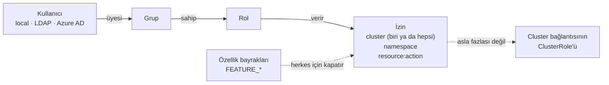

# Erişim modeli

**Yapmak istediğiniz:** erişim vermeden önce, birinin neyi görüp neyi yapabileceğini neyin belirlediğini anlamak.

- **Bir izin** dört şeyden oluşur: bir **cluster** (biri ya da *tüm cluster'lar*), bir **namespace**, bir **kaynak** ve
  bir **aksiyon**; örneğin *staging · shop · `deployments:restart`*. Bütün kaynak ve aksiyonların listesi:
  [Uygulama izinleri](/reference/permissions).
- **Bir rol** adı olan bir izin kümesidir (`shop-developer`). **Bir grup**, bir ya da daha fazla rol alan bir kullanıcı
  kümesidir. Kullanıcı izinleri **yalnızca gruplar üzerinden** alır; hiçbir grupta olmayan kullanıcı hiçbir şey görmez.
- **Birden fazla rol toplanır.** "Deny" yoktur: kullanıcının rollerinden herhangi birinden gelen izin geçerlidir.
- **Namespace'ler her zaman adıyla verilir.** Bir izin tek bir namespace'i adlandırır; "her namespace" joker karakteri
  yoktur. "Bütün namespace'ler" için bir rol her birini tek tek listeler (rol editöründeki *Eşleşen N tanesini seç*
  hepsini bir seferde seçer); sonradan oluşturulan bir namespace'in eklenmesi gerekir.
- **Görünürlük izinlere bağlıdır.** Namespace listesi, Panel sekmeleri ve Canlı olaylar yalnızca kullanıcının o anki
  cluster'ında en az bir izni olan şeyleri gösterir. Diğer adlar tarayıcıya hiç gönderilmez.
- **Değişiklikler bir sonraki tıklamada geçerli olur.** Rol, grup ya da üyelik eklemek veya kaldırmak yeniden giriş
  gerektirmez.

## Adminler {/* #admins */}

**Admin** her yerde her izne sahiptir, her cluster'ı görür ve Genel bakış, Node'lar ve Yönetim ekranlarını (kullanıcılar,
roller, cluster'lar, denetim logları, kayıtlar, ayarlar) açabilen tek kişidir. Admin ya hep ya hiçtir: "kullanıcı
yöneticisi" ya da "denetim okuyucusu" gibi bir rol yoktur. Admin sayısını az tutun, diğer herkese rol verin.

## Her rolün üstünde iki tavan {/* #two-ceilings-above-every-role */}

1. **Cluster bağlantısı.** OpenConsole bir cluster üzerinde tek bir kimlikle işlem yapar (genellikle `openconsole-reader`
   ServiceAccount'u). Onun ClusterRole'ünün izin vermediği şey, adminler dahil herkes için Kubernetes 403'üyle başarısız
   olur ([Cluster bağlamak](/installation/connect-cluster#what-each-clusterrole-rule-is-for)).
2. **Özellik bayrakları.** `FEATURE_POD_EXEC=false` ve diğer `FEATURE_*` değişkenleri, roller ne derse desin bir yeteneği
   **adminler dahil herkes için** kapatır ([Özelleştirme ve özellik bayrakları](/administration/customization-and-flags)).

API anahtarları kullanıcı başına üçüncü bir tavan ekler: admin'in [API erişimi politikası](/administration/api-access-policy),
bir kullanıcının izinlerinin ne kadarını anahtarlarının kullanabileceğini sınırlar.

## Her şey audit'e yazılır {/* #everything-is-audited */}

İzin verilen ve reddedilen her aksiyon; kullanıcı, cluster, namespace, kaynak ve sonuçla birlikte bir audit olayıdır
([Denetim logları](/administration/audit-log)). Reddedilen bir deneme gerekçesiyle birlikte `denied` olarak yazılır;
böylece eksik bir izin, kullanıcı sormadan orada görünür.

Sırada: yaygın ekipler için [Tarifler](/administration/recipes), sonra ekranlar için
[Roller ve izinler](/administration/roles).
