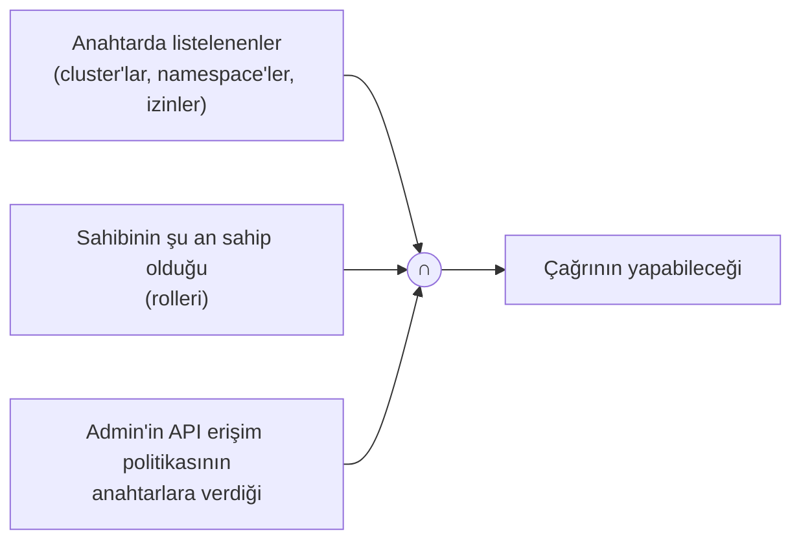

# API ve agent'lar

Bir **API anahtarı**, bir script'in ya da bir AI agent'ın (Claude Code, Cursor, bir shell script'i) OpenConsole
API'sini sizin adınıza çağırmasını sağlar. Web arayüzünün kullandığı API'nin aynısıdır; `GET /api/openapi.json`
adresinde (giriş gerekmez) OpenAPI 3.1 ile ve [uç referansında](/api/endpoints/openconsole-api) tanımlıdır.

- **Başlarken:** [Hızlı başlangıç](/api/quick-start) (`curl` ile ilk çağrılar), [Agent tarifleri](/api/agent-recipes)
  (Claude Code, Cursor, bir shell script'i), [Limitler](/api/limits).
- **Anahtar oluşturma ve yönetme:** [API anahtarlarınız](/user-guide/api-keys) (kullanım kılavuzu). **Anahtarların
  neler yapabileceğine karar verme:** [API erişim politikası](/administration/api-access-policy) (adminler).

## Bir anahtar nelere erişebilir {#what-a-key-can-reach}

Bir anahtar, her çağrı anında üç şeyin birlikte izin verdiğinden fazlasına hiçbir zaman erişemez:

- **Anahtarın kendi kapsamı:** cluster'lar (tümü ya da biri), namespace'ler (sahibinin tüm namespace'leri, sonradan
  kazanacakları dahil, ya da bir seçim) ve izinler; anahtar oluşturulurken seçilir.
- **Sahibinin şu anki izinleri:** sahibinin rolünden bir namespace'i çıkarırsanız anahtarları onu bir sonraki
  çağrıda kaybeder; sahibine daha fazla izin verirseniz anahtarları kendiliğinden büyümez.
- **API erişim politikası:** rol başına *Kapalı*, *Güvenli salt okuma* (varsayılan: `list`, `get`, `logs`;
  ConfigMap ve Secret hariç) ya da *Rolün tüm yetkileri*; isterseniz kullanıcı başına bir istisna.

Bunlardan herhangi birinin dışında kalan bir çağrı 403 ile reddedilir ve gövdenin `error` alanında bir neden kodu yazar: `forbidden`
(anahtarda yok ya da sahip olunmuyor), `api_access_policy` (sahip olunuyor ama politika anahtarlara vermiyor),
`api_access_off` (politika bu kullanıcının anahtarlarına hiçbir şey vermiyor), `feature_disabled` (operatör bu
özelliği kapattı). Tam liste [Hızlı başlangıç](/api/quick-start#errors) sayfasında.

**Bir anahtar hiçbir zaman** anahtar oluşturamaz ya da değiştiremez, parola değiştiremez, seçili cluster'ınızı
değiştiremez ya da görünüm kaydedemez (403 `api_key_not_allowed`); admin uçları (`/api/admin/*`) için, bir admin'in
**Admin API** kutusu işaretlenerek oluşturulmuş anahtarı gerekir.

## Neler kaydedilir {#what-is-recorded}

- **Audit:** bir anahtarla yapılan her aksiyon ve her kaynak okuması, kullanıcınız **ve anahtarın adıyla**
  (`api_key_name`; ECS'te `openconsole.api_key.name`) bir audit olayıdır. Yardımcı çağrılar (`/api/auth/me`,
  `/api/ws-ticket`, `/api/features`, `/api/openapi.json`, `/api/version`) audit'e yazılmaz; istek logunda yine de yer alırlar. Bkz.
  [Audit olayları](/reference/audit-events).
- Anahtarla çalıştırılan **shell'ler ve komutlar**, web oturumları için kayıt kapalı olsa bile her zaman kaydedilir;
  kaydedilemiyorlarsa reddedilir (503 `recording_unavailable`).
- **Anahtar olayları:** `api_key.create`, `update`, `regenerate`, `revoke`, `delete`; bir anahtar reddedildiğinde ya
  da hız limitine takıldığında `api_key.use`. Reddedilen bir anahtarın `api_key.use` olayı `denied` sonucunu ve
  `expired`, `revoked`, `owner_inactive`, `must_change_password` ya da `api_access_off` nedenini taşır; anahtar ve
  neden başına dakikada en fazla bir kez yazılır (her istek yine de 401 / 403 cevabını alır). Bilinmeyen bir anahtarın
  kullanıcısı yoktur; bu yüzden yalnızca konsol logunda, kaynak IP'siyle bir uyarı satırı olarak görünür.

## Anahtarı prompt'un dışında tutun {#keep-the-key-out-of-the-prompt}

Anahtarı agent'ın çalıştığı yerde bir ortam değişkenine (`OPENCONSOLE_API_KEY`) koyun; asla bir prompt'a,
repository'deki bir dosyaya ya da bir URL'e yazmayın. OpenConsole URL'deki anahtarı hiçbir zaman kabul etmez;
WebSocket'ler bunun yerine tek kullanımlık bir ticket alır ([Limitler](/api/limits#websockets)). Tarifler anahtarı
agent'ın yazdığı komutların dışında tutar; böylece anahtar hiçbir transcript'te görünmez.
