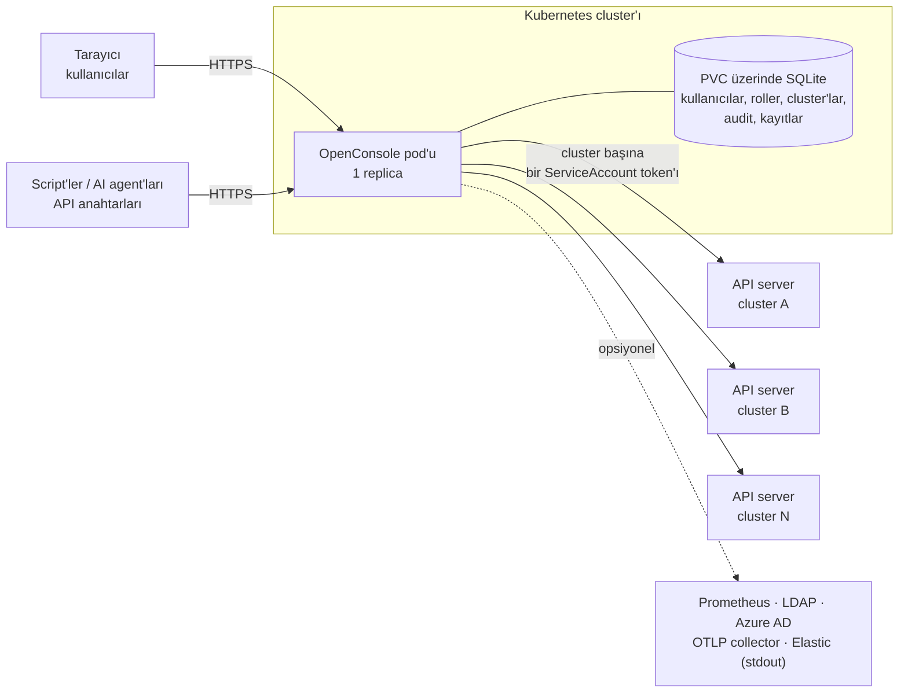

# Giriş

OpenConsole for Kubernetes, birden çok Kubernetes cluster'ı için bir web konsoludur. Kullanıcılar yerel, LDAP ya da
Azure AD hesabıyla giriş yapar. Kendilerine verilen namespace'lerdeki iş yüklerini görür, rolleri izin veriyorsa
bunlar üzerinde işlem de yaparlar: pod durumu ve logları, shell, restart ve ölçekleme, YAML düzenleme, Secret'lar.
Her aksiyon ve her okuma audit'e yazılır. Script'ler ve AI agent'ları da aynı kurallara tabidir; kapsamı sınırlı
API anahtarlarıyla bir REST API üzerinden çalışırlar.

**Kimin için:** Geliştiricilere, destek ekibine ve nöbetçilere kubeconfig dağıtmadan cluster'lara bakış imkânı
vermek isteyen ve kimin neye baktığını ya da neyi değiştirdiğini tek bir yerde kayıt altına almak isteyen platform
ekipleri.

## Nasıl çalışır {#how-it-works}

- **Her cluster için tek kimlik.** OpenConsole her cluster'la, bir yöneticinin arayüzden eklediği tek bir
  ServiceAccount token'ı (ya da kubeconfig) ile konuşur. Bu kimliğin ClusterRole'ü üst sınırdır: kimse onun izin
  verdiğinden fazlasını yapamaz. Kullanıcılar hiçbir zaman Kubernetes kimlik bilgisi almaz.
- **Erişim uygulamada verilir.** Kullanıcı → grup → rol → izin. Bir izin; bir cluster, bir namespace, bir kaynak ve
  bir aksiyondan oluşur (`pods:logs`, `deployments:restart`, `secrets:reveal`, …). Kullanıcı yalnızca izni olan
  namespace'leri görür. Yöneticiler her şeye erişir.
- **Her şey audit'e yazılır.** Her okuma ve yazma tek bir olaydır: kim, nereden, ne, hangi cluster'da ve sonucu.
  Olaylar veritabanında tutulur (Yönetim → Denetim Logları, CSV) ve log pipeline'ınız için stdout'a tek satır JSON
  olarak yazılır. Pod shell'leri kaydedilir ve tekrar oynatılabilir.
- **Tek container, tek veritabanı.** API'yi ve web arayüzünü tek bir Go binary'si sunar. Durum, ReadWriteOnce bir
  volume üzerindeki bir SQLite dosyasındadır; bu yüzden OpenConsole **tam olarak bir replica** ile çalışır.
- **Canlı veri.** OpenConsole her cluster'ı izler (informer'lar); listeler bellekten gelir, API server sürekli
  sorgulanmaz. CPU ve bellek metrics-server'dan, daha uzun geçmiş ise yapılandırdıysanız Prometheus'tan gelir.

## Ne değildir {#what-it-is-not}

- **`kubectl`'ın yerine geçmez.** Yaygın iş yükü türlerinde bakmayı, logları, shell'i, restart'ı, ölçeklemeyi ve
  YAML düzenlemeyi kapsar. Cluster yönetimi (node'lar, RBAC, CRD'ler, storage) her zamanki araçlarınızda kalır.
- **Provisioning ya da GitOps aracı değildir.** Cluster oluşturmaz, chart kurmaz, Git'le uzlaştırma (reconcile)
  yapmaz. OpenConsole'da yapılan bir düzenleme doğrudan bir değişikliktir; GitOps aracınız bunu geri alabilir.
- **Bir Kubernetes güvenlik sınırı değildir.** Şirket içi bir görünürlük ve operasyon platformudur. Kendi
  izinlerini, ServiceAccount'unun yapabildikleri çerçevesinde uygular; Kubernetes'in başka herkese neye izin
  verdiğini değiştirmez.

## Sonra nereye {#where-to-go-next}

| Ne istiyorsunuz | Okuyun |
|---|---|
| Kendi cluster'ınız olmadan, iki dakikada çalışır hâlde görmek | [Hızlı başlangıç (Docker)](/getting-started/quick-start) |
| Pod'ları hata veren yerel bir cluster'da her ekranı denemek | [k3d'de deneyin](/getting-started/try-on-k3d) |
| Ekibiniz için kurmak | [Kubernetes'e kurulum](/installation/kubernetes), ardından [Cluster bağlama](/installation/connect-cluster) ve [İlk giriş](/getting-started/first-login) |
| Yaptığı her şeyi öğrenmek | [Özellikler](/features) |
