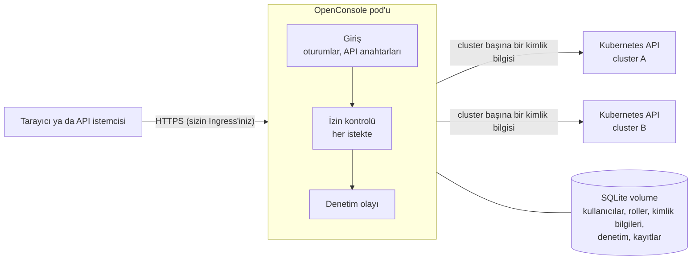

# Güvenlik modeli

Bu sayfa, OpenConsole 2.23.0'ın bağlandığı cluster'ları nasıl koruduğunu güvenlik incelemesi için anlatır. Her ifade,
onu uygulayan kod ya da manifest satırına bağlanır (`v2.23.0` tag'i). Operatörün çevresinde nelerin kurulması
gerektiği [Production sıkılaştırma kontrol listesi](/operations/hardening)'nde.

## OpenConsole bir cluster'da neye erişebilir {#what-openconsole-can-reach-in-a-cluster}

- **Yalnızca bir yöneticinin bağladığına.** OpenConsole bir cluster'la yalnızca bir yöneticinin
  Yönetim → Cluster'lar altında eklediği kimlik bilgileriyle konuşur (bir ServiceAccount token'ı ya da bir kubeconfig).
  Kendi başına cluster bulmaz ve pod'un kendi kimliğini kullanmaz: manifest pod'a hiçbir ServiceAccount token'ı
  mount etmez ([deployment.yaml#L31](https://github.com/vurulkan/kubernetes-openconsole/blob/v2.25.0/deploy/deployment.yaml#L31)).
  Bir kubeconfig yalnızca satır içi kimlik bilgisi taşıyabilir: exec plugin, `auth-provider` ya da dosya yolu içeren
  kubeconfig reddedilir (`kubeconfig_unsupported`); böylece bir cluster bağlamak pod'da program çalıştıramaz ya da
  dosya okuyamaz ([manager.go](https://github.com/vurulkan/kubernetes-openconsole/blob/v2.25.0/backend/internal/kube/manager.go)).
- **O kimlik bilgisine verdiğiniz ClusterRole herkes için üst sınırdır**, yöneticiler dahil. Manifest'teki
  ClusterRole ([rbac.yaml#L36-L124](https://github.com/vurulkan/kubernetes-openconsole/blob/v2.25.0/deploy/rbac.yaml#L36-L124)) iş yüklerini, pod'ları, service'leri, ConfigMap'leri,
  event'leri, node'ları ve metrikleri okur; Secret'ları okur ve günceller; pod loglarını okur; `pods/exec` oluşturur;
  iş yüklerini günceller ve patch'ler (YAML apply, restart, ölçekleme). Hiçbir nesnede `create` ya da `delete` yoktur;
  Prometheus için yorumunu kaldırmadığınız sürece `services/proxy` de yoktur. Hiçbir yazma verb'ü içermeyen, yalnızca
  görüntüleme amaçlı bir sürümü de var:
  [rbac-readonly.yaml](https://github.com/vurulkan/kubernetes-openconsole/blob/v2.25.0/deploy/rbac-readonly.yaml#L30). Her kural ve hizmet ettiği özellik:
  [Kubernetes izinleri](/reference/kubernetes-permissions).
- **Kubernetes kişiyi değil OpenConsole'u görür.** API server'ın audit logu, her kullanıcının aksiyonu için bağlı
  kimliği gösterir. İşi kimin yaptığı OpenConsole'un kendi denetim logundadır ([aşağıda](#what-is-recorded)).
- **Bir shell, var olan container'da, o container'ın kullanıcısıyla çalışır**; API server'ın `pods/exec`'i üzerinden
  açılır. Cluster'ın kendi pod politikaları (örneğin root olmayan kullanıcı şartı koyan admission politikaları)
  shell'ler için de geçerlidir.
- **Secret'lar ihtiyaç anında okunur.** Listeler ve iş yükleri bellekteki bir watch cache'inden gelir; Secret'lar
  watch'lanmaz, cache'lenmez, her istek için API server'dan alınır ([resources.go#L526-L545](https://github.com/vurulkan/kubernetes-openconsole/blob/v2.25.0/backend/internal/kube/resources.go#L526-L545),
  kuralın yorumu: [rbac.yaml#L46-L49](https://github.com/vurulkan/kubernetes-openconsole/blob/v2.25.0/deploy/rbac.yaml#L46-L49)).

## Kim ne yapabilir {#who-may-do-what}

- **İzinler OpenConsole'da verilir**, rol bazında: bir namespace'te, tek bir cluster'da ya da hepsinde, bir kaynak ve
  bir aksiyon (`pods:exec`, `secrets:reveal`, …) ([engine.go#L13-L28](https://github.com/vurulkan/kubernetes-openconsole/blob/v2.25.0/backend/internal/rbac/engine.go#L13-L28)).
  Kullanıcılar rolleri gruplar üzerinden alır. Yöneticiler her izne sahiptir
  ([router.go#L72-L81](https://github.com/vurulkan/kubernetes-openconsole/blob/v2.25.0/backend/internal/api/access.go#L72-L81)). Katalog:
  [Uygulama izinleri](/reference/permissions).
- **Server her isteği kontrol eder.** Her handler tek bir kontrolü çağırır
  ([`requirePermission`, router.go#L116-L140](https://github.com/vurulkan/kubernetes-openconsole/blob/v2.25.0/backend/internal/api/access.go#L116-L140)); bu kontrol, çağıranın
  izinlerini isteğin cluster'ı ve namespace'i için değerlendirir ([`Can`, engine.go#L151](https://github.com/vurulkan/kubernetes-openconsole/blob/v2.25.0/backend/internal/rbac/engine.go#L151)).
  Arayüz kullanamayacağınız şeyleri gizler, ama asıl kontrol gizlemek değildir. Reddedilen istek bir sebep koduyla
  `403` döner ve `denied` olarak audit'e yazılır. Yönetim ekranları tek bir yönetici kontrolü kullanır
  ([`isAdminRequest`, router.go#L34-L43](https://github.com/vurulkan/kubernetes-openconsole/blob/v2.25.0/backend/internal/api/access.go#L34-L43)).
- **İlk parolasını değiştirmemiş bir kullanıcının** hiçbir izni olmaz
  ([router.go#L48-L55](https://github.com/vurulkan/kubernetes-openconsole/blob/v2.25.0/backend/internal/api/access.go#L48-L55)); bu durumdaki bir yönetici de yönetici sayılmaz
  ([router.go#L36](https://github.com/vurulkan/kubernetes-openconsole/blob/v2.25.0/backend/internal/api/access.go#L36)).
- **Özellik bayrakları bir yeteneği herkes için kapatır**, yöneticiler dahil, aynı kontrolde: `FEATURE_POD_EXEC`,
  `FEATURE_SECRET_REVEAL`, `FEATURE_API_KEYS`, … ([features.go#L59](https://github.com/vurulkan/kubernetes-openconsole/blob/v2.25.0/backend/internal/api/features.go#L59),
  [router.go#L122-L126](https://github.com/vurulkan/kubernetes-openconsole/blob/v2.25.0/backend/internal/api/access.go#L122-L126)).
- **Bir API anahtarı asla sahibinden fazlası olamaz.** Bir anahtarın yapabildikleri; anahtarda listelenenlerin,
  sahibinin şu an sahip olduklarının ve yöneticinin API erişim politikasının kesişimidir
  ([router.go#L59-L69](https://github.com/vurulkan/kubernetes-openconsole/blob/v2.25.0/backend/internal/api/access.go#L59-L69),
  [`WithKey`, engine.go#L67](https://github.com/vurulkan/kubernetes-openconsole/blob/v2.25.0/backend/internal/rbac/engine.go#L67),
  [`KeyCeiling`, policy.go#L57](https://github.com/vurulkan/kubernetes-openconsole/blob/v2.25.0/backend/internal/rbac/policy.go#L57)). Roller için varsayılan politika *güvenli
  salt okuma*dır: list, get ve loglar; ConfigMap'ler ve Secret'lar hariç ([`SafeRead`, policy.go#L24](https://github.com/vurulkan/kubernetes-openconsole/blob/v2.25.0/backend/internal/rbac/policy.go#L24)).
  Bir anahtar hiçbir zaman anahtar yönetemez, parola değiştiremez, kullanıcının cluster'ını seçemez, görünüm
  kaydedemez ([`denyAPIKey`, apikeys.go#L245](https://github.com/vurulkan/kubernetes-openconsole/blob/v2.25.0/backend/internal/api/apikeys.go#L245)).

## Giriş ve oturumlar {#sign-in-and-sessions}

- **Yerel parolalar** bcrypt hash'i olarak saklanır ([password.go#L12](https://github.com/vurulkan/kubernetes-openconsole/blob/v2.25.0/backend/internal/auth/password.go#L12));
  en az `PASSWORD_MIN_LENGTH` (8) karakter, en fazla 72 bayt olabilir ([password.go#L23-L38](https://github.com/vurulkan/kubernetes-openconsole/blob/v2.25.0/backend/internal/auth/password.go#L23-L38)).
  LDAP hesapları dizine bind ile kontrol edilir; Azure AD hesapları Microsoft üzerinden giriş yapar ve hiçbir zaman
  yerel parola kabul etmez. Bir hesap yalnızca kendi kaynağıyla giriş yapar: local hesap asla dizin parolası kabul etmez,
  Microsoft girişi de asla local ya da LDAP hesabını devralmaz; bir Azure AD hesabı ona ilk giriş yapan Entra nesnesine
  (`oid`) bağlanır ([router.go#L99-L121](https://github.com/vurulkan/kubernetes-openconsole/blob/v2.25.0/backend/internal/api/auth_handlers.go#L99-L121)).
- **Tahmin denemeleri yavaşlatılır:** bir istemci adresinden bir kullanıcı adı için 5 başarısız girişten sonra bu ikili,
  herhangi adreslerden bir kullanıcı adı için 20 başarısız girişten sonra da o ad 5 dakika kilitlenir (`429`,
  `user.login` `locked` olarak audit'e yazılır; 5 dakikadan eski başarısız girişler unutulur)
  ([observability.go#L65-L72](https://github.com/vurulkan/kubernetes-openconsole/blob/v2.25.0/backend/internal/api/observability.go#L65-L72),
  [router.go#L74-L80](https://github.com/vurulkan/kubernetes-openconsole/blob/v2.25.0/backend/internal/api/auth_handlers.go#L74-L80)). Her başarısız giriş aynı `401`'i alır;
  cevap, hesabın var olup olmadığını belli etmez ([router.go#L123-L130](https://github.com/vurulkan/kubernetes-openconsole/blob/v2.25.0/backend/internal/api/auth_handlers.go#L123-L130)).
- **İki adımlı doğrulama** (yerel ve LDAP hesapları, yöneticinin politikası *Kapalı* değilken): TOTP (RFC 6238: 6 hane,
  30 saniye, iki yöne birer adım saat kayması). Açıkken doğru parola yalnızca sunucunun belleğinde tutulan 5 dakikalık
  bir challenge döndürür, oturum değil; oturum koddan sonra başlar
  ([twofactor.go](https://github.com/vurulkan/kubernetes-openconsole/blob/v2.25.0/backend/internal/api/twofactor.go)). Bir kod bir kez kabul edilir: sunucu son kullanılan zaman
  adımını saklar ([totp.go](https://github.com/vurulkan/kubernetes-openconsole/blob/v2.25.0/backend/internal/auth/totp.go)). Yanlış kodlar yanlış parolalarla aynı giriş kilidine
  sayılır ve kilidi yalnızca tamamlanmış bir giriş temizler. Doğrulama anahtarı diğer kimlik bilgileri gibi
  şifrelenerek, on kurtarma kodu SHA-256 özeti olarak saklanır; kodlar, anahtarlar ve kurtarma kodları hiçbir zaman
  audit'e ya da log'a yazılmaz. Politikanın zorunlu tuttuğu ve henüz kurmamış birinin oturumu yalnızca kuruluma
  erişir (başka yerde `403` `two_factor_enrollment_required`). API anahtarları etkilenmez; iki adımlı doğrulama uçları
  onları reddeder. Microsoft hesapları Microsoft'un MFA'sını kullanır; OpenConsole bunu zorunlu tutabilir
  ([Azure AD](../administration/azure-ad.mdx#require-mfa)).
- **Oturumlar** imzalı token'lardır (JWT, HS256; başka algoritmalar reddedilir); Yönetim → Oturumlar'da ayarlanan
  hareketsizlik süresinden sonra (varsayılan 60 dakika), en geç de girişten 12 saat sonra biterler. Hareket bitişi
  server tarafında ileri alır; bir ekranın otomatik yenilemesi ve kendiliğinden yeniden bağlanan bir WebSocket almaz
  ([router.go](https://github.com/vurulkan/kubernetes-openconsole/blob/v2.25.0/backend/internal/api/router.go),
  [sessions.go](https://github.com/vurulkan/kubernetes-openconsole/blob/v2.25.0/backend/internal/store/sessions.go)). Her
  token'ın server tarafında bir kaydı vardır ve bu kayıt her istekte kontrol edilir; böylece bir yönetici tek bir
  oturumu ya da bir kullanıcının bütün oturumlarını süreleri dolmadan iptal edebilir ([router.go#L38-L52](https://github.com/vurulkan/kubernetes-openconsole/blob/v2.25.0/backend/internal/api/auth_handlers.go#L38-L52)).
  Bir kullanıcıyı deaktive etmek oturumlarını anında iptal eder; her yetki kontrolü de (shell'ler, loglar, reveal,
  apply ve API anahtarları dahil) deaktive edilmiş bir kullanıcıyı ya da yöneticinin belirlediği parolayı hâlâ
  değiştirmemiş bir kullanıcıyı reddeder.
- **Tarayıcı oturum token'ını local storage'da tutar** ve `Authorization: Bearer` header'ı olarak gönderir
  ([api.ts#L99](https://github.com/vurulkan/kubernetes-openconsole/blob/v2.25.0/frontend/src/services/api.ts#L99), [api.ts#L139](https://github.com/vurulkan/kubernetes-openconsole/blob/v2.25.0/frontend/src/services/api.ts#L139));
  oturum cookie'si yoktur.
- **WebSocket'ler** (loglar, shell, canlı olaylar) oturum token'ını URL'lerinde hiçbir zaman taşımaz. Sayfa önce,
  30 saniye içinde, tek bir yol için ve yalnızca bir kez kullanılabilen bir ticket ister
  ([ticket.go#L11-L50](https://github.com/vurulkan/kubernetes-openconsole/blob/v2.25.0/backend/internal/auth/ticket.go#L11-L50)).
- **API anahtarları** `oc_` ile başlar; böylece secret tarayıcıları onları tanır ([middleware.go#L43-L44](https://github.com/vurulkan/kubernetes-openconsole/blob/v2.25.0/backend/internal/auth/middleware.go#L43-L44)).
  Secret bir kez gösterilir; veritabanı onun SHA-256 özetini saklar
  ([apikeys.go#L71-L75](https://github.com/vurulkan/kubernetes-openconsole/blob/v2.25.0/backend/internal/api/apikeys.go#L71-L75)). Anahtarların süresi dolar (en uzun ömrü
  yönetici belirler), sahibi ya da bir yönetici tarafından iptal edilebilir ve her biri saniyede 10 istekle, 30'luk
  patlamalarla sınırlıdır ([apikeys.go#L44-L45](https://github.com/vurulkan/kubernetes-openconsole/blob/v2.25.0/backend/internal/api/apikeys.go#L44-L45)).

## Veriler nerede saklanır {#where-data-is-kept}

OpenConsole'un sakladığı her şey, volume'undaki tek bir SQLite veritabanındadır (`/data/app.db`); shell kayıtları da
`/data/recordings`'tedir: kullanıcılar ve parola hash'leri, gruplar, roller, cluster kimlik bilgileri, LDAP ve Azure AD
ayarları, Prometheus ayarları, oturumlar, API anahtarı özetleri ve denetim logu.

- **Kimlik bilgileri yazılmadan önce şifrelenir:** cluster token'ları, kubeconfig'ler ve CA sertifikaları
  ([clusters.go#L128-L139](https://github.com/vurulkan/kubernetes-openconsole/blob/v2.25.0/backend/internal/store/clusters.go#L128-L139)), LDAP bind parolası
  ([store.go#L548](https://github.com/vurulkan/kubernetes-openconsole/blob/v2.25.0/backend/internal/store/store.go#L548)), Azure AD client secret'ı
  ([store.go#L631](https://github.com/vurulkan/kubernetes-openconsole/blob/v2.25.0/backend/internal/store/store.go#L631)) ve Prometheus ayarları
  ([clusters.go#L263-L273](https://github.com/vurulkan/kubernetes-openconsole/blob/v2.25.0/backend/internal/store/clusters.go#L263-L273)); her değer için rastgele bir nonce ile,
  AES-256-GCM kullanılarak ([crypto.go#L12-L30](https://github.com/vurulkan/kubernetes-openconsole/blob/v2.25.0/backend/internal/store/crypto.go#L12-L30)).
- **Anahtar nerede.** Varsayılan olarak ilk açılışta üretilir ve aynı veritabanında tutulur; oturum token'larını da
  o imzalar: veritabanı dosyasının bir kopyasına (volume, snapshot, yedek) sahip olan, cluster kimlik bilgilerine de
  sahiptir ve oturum oluşturabilir. `ENCRYPTION_KEY_FILE` ile anahtar bunun yerine bir Kubernetes Secret'ında durur:
  bir sonraki açılış her değeri onunla yeniden şifreler, anahtarı veritabanından siler ve eski anahtar kalmasın diye
  dosyayı yeniden yazar; oturum token'larını da ondan türetilen bir anahtarla imzalar, bu yüzden herkes bir kez daha
  giriş yapar ([keys.go](https://github.com/vurulkan/kubernetes-openconsole/blob/v2.25.0/backend/internal/store/keys.go),
  [Yedekleme ve geri yükleme](/installation/backup-restore)). Bundan sonra
  veritabanının bir kopyası tek başına kimlik bilgilerini açığa çıkarmaz. Her iki durumda da volume'u, snapshot'larını
  ve yedeklerini koruyun; OpenConsole pod'una kimlerin debug container bağlayabileceğini ya da volume'unu
  okuyabileceğini sınırlayın.
- **Shell kayıtları, bir shell'in ekrana bastığı her şeyi içerir**; birinin görüntülediği herhangi bir secret da buna
  dahildir. Aynı volume'dadırlar ve yalnızca yöneticiler oynatabilir ya da indirebilir.

## Neler kayda geçer {#what-is-recorded}

- **Her aksiyon ve her kaynak okuması bir denetim olayıdır**, izin verilmiş de olsa reddedilmiş de olsa: kim, hangi
  adresten, hangi API anahtarıyla, hangi cluster'da, namespace'te ve nesnede, sonuç ne. Olaylar veritabanında
  `LOG_RETENTION_DAYS` (30) gün tutulur ve log platformunuz için stdout'a yazılır ([Loglama](/operations/logging)).
  Olay türleri: [Denetim olayları](/reference/audit-events).
- **Denetim ayrıntıları hiçbir zaman secret değeri, YAML gövdesi, parola ya da token içermez.** Ayrıntılar sabit,
  tipli bir anahtar kümesidir; dışındaki her şey atılır ([event.go#L138-L143](https://github.com/vurulkan/kubernetes-openconsole/blob/v2.25.0/backend/internal/audit/event.go#L138-L143)).
  Bir secret reveal, anahtarın adını kaydeder ([secrets.go#L23-L24](https://github.com/vurulkan/kubernetes-openconsole/blob/v2.25.0/backend/internal/api/secrets.go#L23-L24));
  bir YAML apply, YAML'ı değil, nesnenin önceki ve sonraki hâlinin kısa SHA-256 hash'lerini (8 hex karakter) kaydeder
  ([yaml_apply.go#L119-L121](https://github.com/vurulkan/kubernetes-openconsole/blob/v2.25.0/backend/internal/api/yaml_apply.go#L119-L121),
  [yaml_apply.go#L165-L168](https://github.com/vurulkan/kubernetes-openconsole/blob/v2.25.0/backend/internal/api/yaml_apply.go#L165-L168)).
- **Secret değerleri server'dan yalnızca tek tek istendiğinde çıkar:** list ve get adları, türleri ve anahtar adlarını
  döner; `secrets:reveal` her istekte tek bir anahtarın değerini döner ve her biri audit'e yazılır
  ([secrets.go#L20-L28](https://github.com/vurulkan/kubernetes-openconsole/blob/v2.25.0/backend/internal/api/secrets.go#L20-L28)).
- **Shell'ler kaydedilir**, kayıt açıksa (Yönetim → Kayıtlar). API anahtarıyla açılan bir shell ya da çalıştırılan bir
  komut her zaman kaydedilir; kaydedilemiyorsa reddedilir ([pod_exec.go#L200-L206](https://github.com/vurulkan/kubernetes-openconsole/blob/v2.25.0/backend/internal/api/pod_exec.go#L200-L206),
  [pod_exec_command.go#L188-L193](https://github.com/vurulkan/kubernetes-openconsole/blob/v2.25.0/backend/internal/api/pod_exec_command.go#L188-L193)).

## HTTP {#http}

- OpenConsole 8080 port'unda düz HTTP sunar; TLS, Ingress'inizde ya da Gateway'inizde sonlanır
  ([Kubernetes'e kurulum](/installation/kubernetes#ingress-with-tls)).
- **Her cevaptaki response header'ları** ([observability.go#L17-L44](https://github.com/vurulkan/kubernetes-openconsole/blob/v2.25.0/backend/internal/api/observability.go#L17-L44)):
  `Content-Security-Policy` (script'ler, YAML editörü dahil, yalnızca uygulamanın kendisinden,
  `frame-ancestors 'none'`), `X-Frame-Options: DENY`, `X-Content-Type-Options: nosniff`,
  `Referrer-Policy: strict-origin-when-cross-origin`, konum, kamera, mikrofon ve ödemeyi kapatan
  `Permissions-Policy`. CSP'de ayrıca `worker-src blob:` ve `script-src` içinde `'wasm-unsafe-eval'` vardır; böylece
  uygulamayla gelen kayıt oynatıcısı WebAssembly terminalini derleyebilir. Bu yalnızca WebAssembly derlemesine izin
  verir, JavaScript `eval`'e değil.
- **Giriş olmadan** yalnızca şunlar cevap verir: `/livez`, `/readyz`, `/healthz`, `/metrics`, giriş uçları, logo ve
  `/api/openapi.json` (host adı ya da secret içermeyen API tanımı)
  ([router.go#L186-L223](https://github.com/vurulkan/kubernetes-openconsole/blob/v2.25.0/backend/internal/api/router.go#L186-L223)).
- **Denetim logundaki, Yönetim → Oturumlar'daki ve giriş kilidindeki istemci adresi** bağlantının adresidir.
  `X-Forwarded-For` yalnızca bağlantı `TRUSTED_PROXIES`'te listelenen bir proxy'den geliyorsa ve sağdan okunur: proxy
  olmayan ilk adres kazanır, yani istemcinin kendi yazdığı bir adres asla kullanılmaz; header yoksa `X-Real-Ip`
  ([clientip.go](https://github.com/vurulkan/kubernetes-openconsole/blob/v2.25.0/backend/internal/api/clientip.go)). Manifest özel ağlara güvenir; yapabiliyorsanız
  `TRUSTED_PROXIES`'i Ingress'inize daraltın ve Service'i başka bir yoldan açmayın
  ([Ortam değişkenleri](/reference/environment-variables)).
- **Başka siteler**, origin'leri `ALLOWED_ORIGINS`'te (varsayılan boş) değilse CORS cevabı almaz; konsolun kendi
  sayfaları aynı origin'dendir ve buna ihtiyaç duymaz. Başka bir sitenin sayfasından açılan bir WebSocket (shell,
  loglar, canlı olaylar) `ws.origin_mismatch` olarak loglanır, `WS_ORIGIN_CHECK=enforce` ile reddedilir; `Origin`
  göndermeyen bağlantılar (curl, agent'lar) etkilenmez ([origins.go](https://github.com/vurulkan/kubernetes-openconsole/blob/v2.25.0/backend/internal/api/origins.go)).
- **İstek gövdeleri sınırlıdır**: 1 MiB, YAML apply için 4 MiB, logo yükleme için 6 MiB; daha büyüğü, giriş dahil,
  okunmadan `413` ile reddedilir. Kullanıcı adları en fazla 256 karakterdir.
- **CSV dışa aktarımları** (audit, kullanıcılar, gruplar, API anahtarları) `=`, `+`, `-`, `@`, tab ya da satır başı
  ile başlayan bir hücrenin önüne `'` koyar; böylece bir kullanıcı adı ya da tarayıcının User-Agent'ı bir tabloda
  formüle dönüşemez.

## Container {#the-container}

Manifest tek bir replica'yı root olmayan bir kullanıcıyla (65532) çalıştırır: `seccompProfile: RuntimeDefault`,
bütün capability'ler düşürülmüş, privilege escalation yok, ServiceAccount token'ı yok
([deployment.yaml#L31-L41](https://github.com/vurulkan/kubernetes-openconsole/blob/v2.25.0/deploy/deployment.yaml#L31-L41), [deployment.yaml#L300-L306](https://github.com/vurulkan/kubernetes-openconsole/blob/v2.25.0/deploy/deployment.yaml#L300-L306)).
Kök dosya sistemi salt okunurdur; sunucu yalnızca kendi volume'una (`/data`) ve `/tmp`'deki bir `emptyDir`'e yazar.
İmaj distroless'tır: sunucu binary'si, CA sertifikaları ve saat dilimi verisi; shell, paket yöneticisi ya da ağ
araçları yoktur ([Dockerfile](https://github.com/vurulkan/kubernetes-openconsole/blob/v2.25.0/Dockerfile)).
Release imajları, repository'nin CI'ı tarafından amd64 ve arm64 için, imzalı build provenance ve bir SBOM ile
derlenir ([İmajı doğrulama](/installation/verify-image)).
