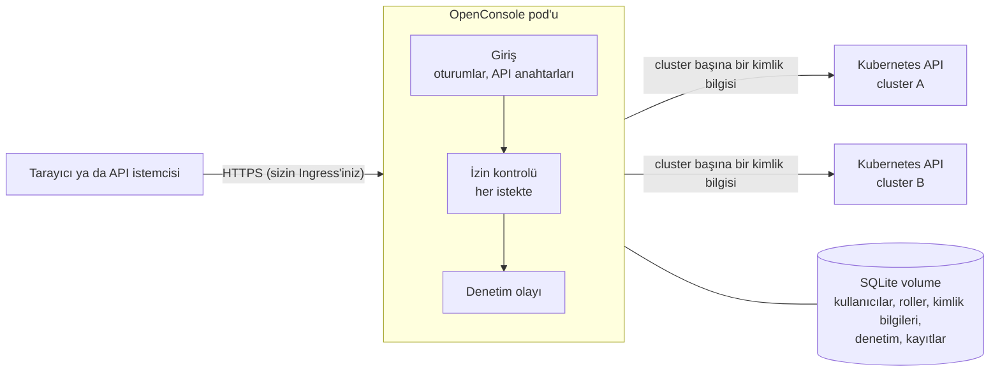

# Güvenlik modeli

Bu sayfa, OpenConsole 2.23.0'ın bağlandığı cluster'ları nasıl koruduğunu güvenlik incelemesi için anlatır. Her ifade,
onu uygulayan kod ya da manifest satırına bağlanır (`v2.23.0` tag'i). Operatörün çevresinde nelerin kurulması
gerektiği [Production sıkılaştırma kontrol listesi](/operations/hardening)'nde.

## OpenConsole bir cluster'da neye erişebilir {#what-openconsole-can-reach-in-a-cluster}

- **Yalnızca bir yöneticinin bağladığına.** OpenConsole bir cluster'la yalnızca bir yöneticinin
  Yönetim → Cluster'lar altında eklediği kimlik bilgileriyle konuşur (bir ServiceAccount token'ı ya da bir kubeconfig).
  Kendi başına cluster bulmaz ve pod'un kendi kimliğini kullanmaz: manifest pod'a hiçbir ServiceAccount token'ı
  mount etmez ([deployment.yaml#L24](https://github.com/vurulkan/kubernetes-openconsole/blob/v2.23.0/deploy/deployment.yaml#L24)).
  Bir kubeconfig yalnızca satır içi kimlik bilgisi taşıyabilir: exec plugin, `auth-provider` ya da dosya yolu içeren
  kubeconfig reddedilir (`kubeconfig_unsupported`); böylece bir cluster bağlamak pod'da program çalıştıramaz ya da
  dosya okuyamaz ([manager.go](https://github.com/vurulkan/kubernetes-openconsole/blob/dev/backend/internal/kube/manager.go)).
- **O kimlik bilgisine verdiğiniz ClusterRole herkes için üst sınırdır**, yöneticiler dahil. Manifest'teki
  ClusterRole ([rbac.yaml#L34-L122](https://github.com/vurulkan/kubernetes-openconsole/blob/v2.23.0/deploy/rbac.yaml#L34-L122)) iş yüklerini, pod'ları, service'leri, ConfigMap'leri,
  event'leri, node'ları ve metrikleri okur; Secret'ları okur ve günceller; pod loglarını okur; `pods/exec` oluşturur;
  iş yüklerini günceller ve patch'ler (YAML apply, restart, ölçekleme). Hiçbir nesnede `create` ya da `delete` yoktur;
  Prometheus için yorumunu kaldırmadığınız sürece `services/proxy` de yoktur. Hiçbir yazma verb'ü içermeyen, yalnızca
  görüntüleme amaçlı bir sürümü de var:
  [rbac-readonly.yaml](https://github.com/vurulkan/kubernetes-openconsole/blob/v2.23.0/deploy/rbac-readonly.yaml#L30). Her kural ve hizmet ettiği özellik:
  [Kubernetes izinleri](/reference/kubernetes-permissions).
- **Kubernetes kişiyi değil OpenConsole'u görür.** API server'ın audit logu, her kullanıcının aksiyonu için bağlı
  kimliği gösterir. İşi kimin yaptığı OpenConsole'un kendi denetim logundadır ([aşağıda](#what-is-recorded)).
- **Bir shell, var olan container'da, o container'ın kullanıcısıyla çalışır**; API server'ın `pods/exec`'i üzerinden
  açılır. Cluster'ın kendi pod politikaları (örneğin root olmayan kullanıcı şartı koyan admission politikaları)
  shell'ler için de geçerlidir.
- **Secret'lar ihtiyaç anında okunur.** Listeler ve iş yükleri bellekteki bir watch cache'inden gelir; Secret'lar
  watch'lanmaz, cache'lenmez, her istek için API server'dan alınır ([resources.go#L521-L540](https://github.com/vurulkan/kubernetes-openconsole/blob/v2.23.0/backend/internal/kube/resources.go#L521-L540),
  kuralın yorumu: [rbac.yaml#L44-L47](https://github.com/vurulkan/kubernetes-openconsole/blob/v2.23.0/deploy/rbac.yaml#L44-L47)).

## Kim ne yapabilir {#who-may-do-what}

- **İzinler OpenConsole'da verilir**, rol bazında: bir namespace'te, tek bir cluster'da ya da hepsinde, bir kaynak ve
  bir aksiyon (`pods:exec`, `secrets:reveal`, …) ([engine.go#L13-L28](https://github.com/vurulkan/kubernetes-openconsole/blob/v2.23.0/backend/internal/rbac/engine.go#L13-L28)).
  Kullanıcılar rolleri gruplar üzerinden alır. Yöneticiler her izne sahiptir
  ([router.go#L2587-L2599](https://github.com/vurulkan/kubernetes-openconsole/blob/v2.23.0/backend/internal/api/router.go#L2587-L2599)). Katalog:
  [Uygulama izinleri](/reference/permissions).
- **Server her isteği kontrol eder.** Her handler tek bir kontrolü çağırır
  ([`requirePermission`, router.go#L2631-L2654](https://github.com/vurulkan/kubernetes-openconsole/blob/v2.23.0/backend/internal/api/router.go#L2631-L2654)); bu kontrol, çağıranın
  izinlerini isteğin cluster'ı ve namespace'i için değerlendirir ([`Can`, engine.go#L151](https://github.com/vurulkan/kubernetes-openconsole/blob/v2.23.0/backend/internal/rbac/engine.go#L151)).
  Arayüz kullanamayacağınız şeyleri gizler, ama asıl kontrol gizlemek değildir. Reddedilen istek bir sebep koduyla
  `403` döner ve `denied` olarak audit'e yazılır. Yönetim ekranları tek bir yönetici kontrolü kullanır
  ([`isAdminRequest`, router.go#L611-L620](https://github.com/vurulkan/kubernetes-openconsole/blob/v2.23.0/backend/internal/api/router.go#L611-L620)).
- **İlk şifresini değiştirmemiş bir kullanıcının** hiçbir izni olmaz
  ([router.go#L2563-L2570](https://github.com/vurulkan/kubernetes-openconsole/blob/v2.23.0/backend/internal/api/router.go#L2563-L2570)); bu durumdaki bir yönetici de yönetici sayılmaz
  ([router.go#L613](https://github.com/vurulkan/kubernetes-openconsole/blob/v2.23.0/backend/internal/api/router.go#L613)).
- **Özellik bayrakları bir yeteneği herkes için kapatır**, yöneticiler dahil, aynı kontrolde: `FEATURE_POD_EXEC`,
  `FEATURE_SECRET_REVEAL`, `FEATURE_API_KEYS`, … ([features.go#L61](https://github.com/vurulkan/kubernetes-openconsole/blob/v2.23.0/backend/internal/api/features.go#L61),
  [router.go#L2636-L2640](https://github.com/vurulkan/kubernetes-openconsole/blob/v2.23.0/backend/internal/api/router.go#L2636-L2640)).
- **Bir API anahtarı asla sahibinden fazlası olamaz.** Bir anahtarın yapabildikleri; anahtarda listelenenlerin,
  sahibinin şu an sahip olduklarının ve yöneticinin API erişim politikasının kesişimidir
  ([router.go#L2574-L2584](https://github.com/vurulkan/kubernetes-openconsole/blob/v2.23.0/backend/internal/api/router.go#L2574-L2584),
  [`WithKey`, engine.go#L67](https://github.com/vurulkan/kubernetes-openconsole/blob/v2.23.0/backend/internal/rbac/engine.go#L67),
  [`KeyCeiling`, policy.go#L57](https://github.com/vurulkan/kubernetes-openconsole/blob/v2.23.0/backend/internal/rbac/policy.go#L57)). Roller için varsayılan politika *güvenli
  salt okuma*dır: list, get ve loglar; ConfigMap'ler ve Secret'lar hariç ([`SafeRead`, policy.go#L24](https://github.com/vurulkan/kubernetes-openconsole/blob/v2.23.0/backend/internal/rbac/policy.go#L24)).
  Bir anahtar hiçbir zaman anahtar yönetemez, şifre değiştiremez, kullanıcının cluster'ını seçemez, görünüm
  kaydedemez ([`denyAPIKey`, apikeys.go#L244](https://github.com/vurulkan/kubernetes-openconsole/blob/v2.23.0/backend/internal/api/apikeys.go#L244)).

## Giriş ve oturumlar {#sign-in-and-sessions}

- **Yerel şifreler** bcrypt hash'i olarak saklanır ([password.go#L12](https://github.com/vurulkan/kubernetes-openconsole/blob/v2.23.0/backend/internal/auth/password.go#L12));
  en az `PASSWORD_MIN_LENGTH` (8) karakter, en fazla 72 bayt olabilir ([password.go#L23-L35](https://github.com/vurulkan/kubernetes-openconsole/blob/v2.23.0/backend/internal/auth/password.go#L23-L35)).
  LDAP hesapları dizine bind ile kontrol edilir; Azure AD hesapları Microsoft üzerinden giriş yapar ve hiçbir zaman
  yerel şifre kabul etmez. Bir hesap yalnızca kendi kaynağıyla giriş yapar: local hesap asla dizin şifresi kabul etmez,
  Microsoft girişi de asla local ya da LDAP hesabını devralmaz; bir Azure AD hesabı ona ilk giriş yapan Entra nesnesine
  (`oid`) bağlanır ([router.go#L656-L681](https://github.com/vurulkan/kubernetes-openconsole/blob/v2.23.0/backend/internal/api/router.go#L656-L681)).
- **Tahmin denemeleri yavaşlatılır:** bir istemci adresinden bir kullanıcı adı için 5 başarısız girişten sonra bu ikili,
  herhangi adreslerden bir kullanıcı adı için 20 başarısız girişten sonra da o ad 5 dakika kilitlenir (`429`,
  `user.login` `locked` olarak audit'e yazılır; 5 dakikadan eski başarısız girişler unutulur)
  ([observability.go#L62-L67](https://github.com/vurulkan/kubernetes-openconsole/blob/v2.23.0/backend/internal/api/observability.go#L62-L67),
  [router.go#L632-L638](https://github.com/vurulkan/kubernetes-openconsole/blob/v2.23.0/backend/internal/api/router.go#L632-L638)). Her başarısız giriş aynı `401`'i alır;
  cevap, hesabın var olup olmadığını belli etmez ([router.go#L684-L690](https://github.com/vurulkan/kubernetes-openconsole/blob/v2.23.0/backend/internal/api/router.go#L684-L690)).
- **Oturumlar** imzalı token'lardır (JWT, HS256; başka algoritmalar reddedilir); ömürleri Yönetim → Oturumlar'dan ayarlanır (varsayılan 60 dakika)
  ([jwt.go#L23-L35](https://github.com/vurulkan/kubernetes-openconsole/blob/v2.23.0/backend/internal/auth/jwt.go#L23-L35), [db.go#L344](https://github.com/vurulkan/kubernetes-openconsole/blob/v2.23.0/backend/internal/db/db.go#L344)). Her
  token'ın server tarafında bir kaydı vardır ve bu kayıt her istekte kontrol edilir; böylece bir yönetici tek bir
  oturumu ya da bir kullanıcının bütün oturumlarını süreleri dolmadan iptal edebilir ([router.go#L95-L109](https://github.com/vurulkan/kubernetes-openconsole/blob/v2.23.0/backend/internal/api/router.go#L95-L109)).
  Bir kullanıcıyı deaktive etmek oturumlarını anında iptal eder; her yetki kontrolü de (shell'ler, loglar, reveal,
  apply ve API anahtarları dahil) deaktive edilmiş bir kullanıcıyı ya da yöneticinin belirlediği şifreyi hâlâ
  değiştirmemiş bir kullanıcıyı reddeder.
- **Tarayıcı oturum token'ını local storage'da tutar** ve `Authorization: Bearer` header'ı olarak gönderir
  ([api.ts#L78](https://github.com/vurulkan/kubernetes-openconsole/blob/v2.23.0/frontend/src/services/api.ts#L78), [api.ts#L112](https://github.com/vurulkan/kubernetes-openconsole/blob/v2.23.0/frontend/src/services/api.ts#L112));
  oturum cookie'si yoktur.
- **WebSocket'ler** (loglar, shell, canlı olaylar) oturum token'ını URL'lerinde hiçbir zaman taşımaz. Sayfa önce,
  30 saniye içinde, tek bir yol için ve yalnızca bir kez kullanılabilen bir ticket ister
  ([ticket.go#L11-L50](https://github.com/vurulkan/kubernetes-openconsole/blob/v2.23.0/backend/internal/auth/ticket.go#L11-L50)).
- **API anahtarları** `oc_` ile başlar; böylece secret tarayıcıları onları tanır ([middleware.go#L37-L38](https://github.com/vurulkan/kubernetes-openconsole/blob/v2.23.0/backend/internal/auth/middleware.go#L37-L38)).
  Secret bir kez gösterilir; veritabanı onun SHA-256 özetini saklar
  ([apikeys.go#L70-L74](https://github.com/vurulkan/kubernetes-openconsole/blob/v2.23.0/backend/internal/api/apikeys.go#L70-L74)). Anahtarların süresi dolar (en uzun ömrü
  yönetici belirler), sahibi ya da bir yönetici tarafından iptal edilebilir ve her biri saniyede 10 istekle, 30'luk
  patlamalarla sınırlıdır ([apikeys.go#L43-L44](https://github.com/vurulkan/kubernetes-openconsole/blob/v2.23.0/backend/internal/api/apikeys.go#L43-L44)).

## Veriler nerede saklanır {#where-data-is-kept}

OpenConsole'un sakladığı her şey, volume'undaki tek bir SQLite veritabanındadır (`/data/app.db`); shell kayıtları da
`/data/recordings`'tedir: kullanıcılar ve şifre hash'leri, gruplar, roller, cluster kimlik bilgileri, LDAP ve Azure AD
ayarları, Prometheus ayarları, oturumlar, API anahtarı özetleri ve denetim logu.

- **Kimlik bilgileri yazılmadan önce şifrelenir:** cluster token'ları, kubeconfig'ler ve CA sertifikaları
  ([clusters.go#L100-L111](https://github.com/vurulkan/kubernetes-openconsole/blob/v2.23.0/backend/internal/store/clusters.go#L100-L111)), LDAP bind şifresi
  ([store.go#L489](https://github.com/vurulkan/kubernetes-openconsole/blob/v2.23.0/backend/internal/store/store.go#L489)), Azure AD client secret'ı
  ([store.go#L571](https://github.com/vurulkan/kubernetes-openconsole/blob/v2.23.0/backend/internal/store/store.go#L571)) ve Prometheus ayarları
  ([clusters.go#L235-L245](https://github.com/vurulkan/kubernetes-openconsole/blob/v2.23.0/backend/internal/store/clusters.go#L235-L245)); her değer için rastgele bir nonce ile,
  AES-256-GCM kullanılarak ([crypto.go#L12-L30](https://github.com/vurulkan/kubernetes-openconsole/blob/v2.23.0/backend/internal/store/crypto.go#L12-L30)).
- **Anahtar ilk açılışta üretilir ve aynı veritabanında saklanır** ([store.go#L37-L55](https://github.com/vurulkan/kubernetes-openconsole/blob/v2.23.0/backend/internal/store/store.go#L37-L55));
  oturum token'larını da aynı anahtar imzalar ([store.go#L29-L31](https://github.com/vurulkan/kubernetes-openconsole/blob/v2.23.0/backend/internal/store/store.go#L29-L31),
  [router.go#L132](https://github.com/vurulkan/kubernetes-openconsole/blob/v2.23.0/backend/internal/api/router.go#L132)). Veritabanı dosyasının bir kopyasına sahip olan, cluster
  kimlik bilgilerine de sahiptir ve oturum oluşturabilir. Volume'u, snapshot'larını ve yedeklerini cluster kimlik
  bilgilerinin kendisi gibi koruyun; OpenConsole pod'una kimlerin exec yapabileceğini ya da volume'unu
  okuyabileceğini sınırlayın.
- **Shell kayıtları, bir shell'in ekrana bastığı her şeyi içerir**; birinin görüntülediği herhangi bir secret da buna
  dahildir. Aynı volume'dadırlar ve yalnızca yöneticiler oynatabilir ya da indirebilir.

## Neler kayda geçer {#what-is-recorded}

- **Her aksiyon ve her kaynak okuması bir denetim olayıdır**, izin verilmiş de olsa reddedilmiş de olsa: kim, hangi
  adresten, hangi API anahtarıyla, hangi cluster'da, namespace'te ve nesnede, sonuç ne. Olaylar veritabanında
  `LOG_RETENTION_DAYS` (30) gün tutulur ve log platformunuz için stdout'a yazılır ([Loglama](/operations/logging)).
  Olay türleri: [Denetim olayları](/reference/audit-events).
- **Denetim ayrıntıları hiçbir zaman secret değeri, YAML gövdesi, şifre ya da token içermez.** Ayrıntılar sabit,
  tipli bir anahtar kümesidir; dışındaki her şey atılır ([event.go#L131-L136](https://github.com/vurulkan/kubernetes-openconsole/blob/v2.23.0/backend/internal/audit/event.go#L131-L136)).
  Bir secret reveal, anahtarın adını kaydeder ([secrets.go#L24-L25](https://github.com/vurulkan/kubernetes-openconsole/blob/v2.23.0/backend/internal/api/secrets.go#L24-L25));
  bir YAML apply, YAML'ı değil, nesnenin önceki ve sonraki hâlinin kısa SHA-256 hash'lerini (8 hex karakter) kaydeder
  ([yaml_apply.go#L115-L117](https://github.com/vurulkan/kubernetes-openconsole/blob/v2.23.0/backend/internal/api/yaml_apply.go#L115-L117),
  [yaml_apply.go#L161-L164](https://github.com/vurulkan/kubernetes-openconsole/blob/v2.23.0/backend/internal/api/yaml_apply.go#L161-L164)).
- **Secret değerleri server'dan yalnızca tek tek istendiğinde çıkar:** list ve get adları, türleri ve anahtar adlarını
  döner; `secrets:reveal` her istekte tek bir anahtarın değerini döner ve her biri audit'e yazılır
  ([secrets.go#L21-L29](https://github.com/vurulkan/kubernetes-openconsole/blob/v2.23.0/backend/internal/api/secrets.go#L21-L29)).
- **Shell'ler kaydedilir**, kayıt açıksa (Yönetim → Kayıtlar). API anahtarıyla açılan bir shell ya da çalıştırılan bir
  komut her zaman kaydedilir; kaydedilemiyorsa reddedilir ([pod_exec.go#L192-L198](https://github.com/vurulkan/kubernetes-openconsole/blob/v2.23.0/backend/internal/api/pod_exec.go#L192-L198),
  [pod_exec_command.go#L181-L186](https://github.com/vurulkan/kubernetes-openconsole/blob/v2.23.0/backend/internal/api/pod_exec_command.go#L181-L186)).

## HTTP {#http}

- OpenConsole 8080 port'unda düz HTTP sunar; TLS, Ingress'inizde ya da Gateway'inizde sonlanır
  ([Kubernetes'e kurulum](/installation/kubernetes#ingress-with-tls)).
- **Her cevaptaki response header'ları** ([observability.go#L17-L46](https://github.com/vurulkan/kubernetes-openconsole/blob/v2.23.0/backend/internal/api/observability.go#L17-L46)):
  `Content-Security-Policy` (script'ler yalnızca uygulamanın kendisinden ve YAML editörü için `cdn.jsdelivr.net`'ten,
  `frame-ancestors 'none'`), `X-Frame-Options: DENY`, `X-Content-Type-Options: nosniff`,
  `Referrer-Policy: strict-origin-when-cross-origin`, konum, kamera, mikrofon ve ödemeyi kapatan
  `Permissions-Policy`. CSP'de ayrıca `worker-src blob:` ve `script-src` içinde `'wasm-unsafe-eval'` vardır; böylece
  uygulamayla gelen kayıt oynatıcısı WebAssembly terminalini derleyebilir. Bu yalnızca WebAssembly derlemesine izin
  verir, JavaScript `eval`'e değil.
- **Giriş olmadan** yalnızca şunlar cevap verir: `/livez`, `/readyz`, `/healthz`, `/metrics`, giriş uçları, logo ve
  `/api/openapi.json` (host adı ya da secret içermeyen API tanımı)
  ([router.go#L174-L210](https://github.com/vurulkan/kubernetes-openconsole/blob/v2.23.0/backend/internal/api/router.go#L174-L210)).
- **Denetim logundaki, Yönetim → Oturumlar'daki ve giriş kilidindeki istemci adresi** bağlantının adresidir.
  `X-Forwarded-For` yalnızca bağlantı `TRUSTED_PROXIES`'te listelenen bir proxy'den geliyorsa ve sağdan okunur: proxy
  olmayan ilk adres kazanır, yani istemcinin kendi yazdığı bir adres asla kullanılmaz; header yoksa `X-Real-Ip`
  ([clientip.go](https://github.com/vurulkan/kubernetes-openconsole/blob/dev/backend/internal/api/clientip.go)). Manifest özel ağlara güvenir; yapabiliyorsanız
  `TRUSTED_PROXIES`'i Ingress'inize daraltın ve Service'i başka bir yoldan açmayın
  ([Ortam değişkenleri](/reference/environment-variables)).
- **İstek gövdeleri sınırlıdır**: 1 MiB, YAML apply için 4 MiB, logo yükleme için 6 MiB; daha büyüğü, giriş dahil,
  okunmadan `413` ile reddedilir. Kullanıcı adları en fazla 256 karakterdir.
- **CSV dışa aktarımları** (audit, kullanıcılar, gruplar, API anahtarları) `=`, `+`, `-`, `@`, tab ya da satır başı
  ile başlayan bir hücrenin önüne `'` koyar; böylece bir kullanıcı adı ya da tarayıcının User-Agent'ı bir tabloda
  formüle dönüşemez.

## Container {#the-container}

Manifest tek bir replica'yı root olmayan bir kullanıcıyla (65532) çalıştırır: `seccompProfile: RuntimeDefault`,
bütün capability'ler düşürülmüş, privilege escalation yok, ServiceAccount token'ı yok
([deployment.yaml#L24-L31](https://github.com/vurulkan/kubernetes-openconsole/blob/v2.23.0/deploy/deployment.yaml#L24-L31), [deployment.yaml#L227-L231](https://github.com/vurulkan/kubernetes-openconsole/blob/v2.23.0/deploy/deployment.yaml#L227-L231)).
Release imajları, repository'nin CI'ı tarafından amd64 ve arm64 için, imzalı build provenance ve bir SBOM ile
derlenir ([İmajı doğrulama](/installation/verify-image)).
